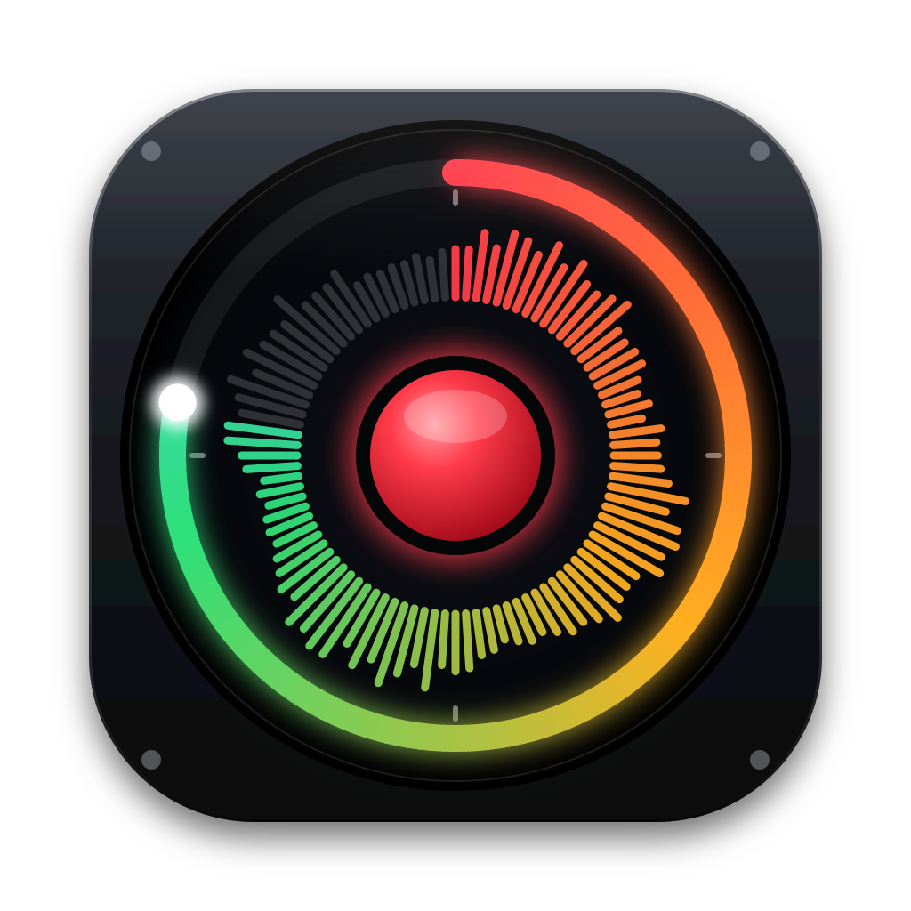

# Looper — a native macOS phrase looper modeled on the BOSS RC-5

A native SwiftUI + AVAudioEngine app for macOS 13+ (Apple silicon and Intel). It works like the RC-5: one stereo track, one pedal, rhythm guide, 99 phrase memories.



**Current version: 1.8**. Highlights:
- **Looping:** overdub/replace with undo, and a live loop tempo (keep pitch or varispeed).
- **Rhythm:** 57 patterns played on real recorded drums, with intro, ending and fills.
- **Audio and MIDI:** audio interface support (device, channel and buffer selection), MIDI control, and MIDI clock in and out.

## Download

Ready-made builds are on the [Releases page](https://github.com/lydianb79/RC5-Looper/releases/latest):

| File | For |
|---|---|
| `Looper-<version>-arm64.zip` → **Looper (arm64).app** | Apple silicon Macs (M1, M2, M3, M4) |
| `Looper-<version>-x86_64.zip` → **Looper (x86_64).app** | Intel Macs (also runs on Apple silicon under Rosetta) |

The apps are ad-hoc signed, not notarized. On first launch, right-click the app, choose **Open** and confirm. macOS then asks for microphone access.

## Build from source

Requirements: macOS 13 Ventura or later, plus Xcode 15+ (or the Xcode Command Line Tools with Swift 5.9+).

```bash
git clone https://github.com/lydianb79/RC5-Looper.git
cd RC5-Looper
./build_app.sh release --open      # builds build/Looper.app for this Mac and launches it
```

To update later, run `git pull && ./build_app.sh release --open`. Copy `build/Looper.app` to /Applications if you like.

You can also run `open Package.swift` to work in Xcode. For recording, run the bundled app from the build script: a bare executable has no `NSMicrophoneUsageDescription`, so macOS won't grant it microphone access.

### Building for a specific architecture

```bash
swift build -c release --arch arm64     # Apple silicon
swift build -c release --arch x86_64    # Intel (cross-compiles fine on Apple silicon)
```

### Automated builds (GitHub Actions)

`.github/workflows/build.yml` builds both architectures on a macOS runner. It packages them as labelled, ad-hoc signed apps, `Looper (arm64).app` and `Looper (x86_64).app`, and publishes them as the GitHub release `v<version>`. The version is taken from `LooperController.version`.

To make a new release:
1. Raise `static let version` in `Sources/Looper/Model/LooperController.swift` and push.
2. On GitHub, go to **Actions › Build macOS apps › Run workflow**.

Running the workflow again for the same version replaces that release's files.

## First steps

1. **Audio** tab (also the AUDIO key on the panel, or ⌘,): choose the input and output device (built-in, a USB/Thunderbolt audio interface, or an aggregate device), the input channels, the output pair and the buffer size.
2. Set **Latency compensation** (also on the Audio tab) so overdubs line up with what you hear.
3. Press **Space** (or click the big pedal) to record, press again to close the loop, and keep pressing to overdub.
4. Turn on **Rhythm** and pick a pattern and kit on the Rhythm tab. Use **WRITE** (⌘S) to save the loop to one of the 99 memories.

## RC-5 feature mapping

| RC-5 | Looper |
|---|---|
| 1 stereo track, 32-bit float | Stereo 32-bit float engine at the device sample rate. Max loop length is set on the Audio tab (default 10 min; memory is only used for what you record). |
| Pedal: REC → DUB → PLAY | Big pedal / **Space**. Rec action can be REC→DUB→PLAY or REC→PLAY→DUB. |
| Double press = STOP | Double-press the pedal (or **Esc**, the STOP footswitch). |
| Hold pedal = UNDO/REDO, hold when stopped = CLEAR | Same (2 s hold). UNDO/REDO and CLEAR footswitches too. |
| Overdub / Replace dub mode | Both modes. Replace is also undoable. |
| Loop quantize | Loop length snaps to whole bars when the rhythm is on. |
| Auto rec, count-in | Both, with an adjustable auto-rec threshold. |
| Start: immediate / fade in · Stop: immediate / fade out / loop end | All of them, with adjustable fade time. A second stop press stops right away. |
| One shot, reverse | Both. |
| Tempo: tap / derived from loop, change loop tempo | Tap tempo (**T**). Without rhythm, the tempo is worked out from the loop length. After recording, the tempo stays live: changing it (slider, tap, ±) speeds the loop up or down from 50 % to 200 % and the rhythm follows. **Keep pitch** uses a granular time-stretch; **Varispeed** works like tape, so the pitch follows the speed. You can overdub at any tempo. **Original tempo** returns to the recorded speed. |
| — | Audio device selection (input/output). On multichannel interfaces you can choose the input channels and the output pair (Outputs 1–2, 3–4, …). Buffer size from 32 to 2048 frames. |
| 57 rhythm patterns × 2 variations, 7 kits, rhythm reverb | 57 patterns (Rock, Pop, Funk, Blues, Jazz, Latin, Reggae, Metal, Electronic, Country, odd meters, metronome), each with variations A and B. The 7 kits are Studio, Live, Light (brushes), Heavy, Rock (rimshots), Metal and Electronic (synthesized 808/909 style). The acoustic kits play **real multi-mic drum recordings**: Karoryfer *Big Rusty Drums*, CC0, bundled in `Resources/Drums`. Each drum has 3 velocity layers × 2 round-robin takes and is tuned and saturated per kit. Playback uses a 32-voice engine, so cymbals ring out, the closed hi-hat chokes the open one, and each kit has its own room reverb. |
| Rhythm intro / ending, fill-in | **Intro**: a one-bar count with a fill before recording starts. **Ending**: STOP plays a fill and stops loop and rhythm together on the next bar line with a crash and kick. Press STOP again to stop right away. Switching variation A↔B plays a fill in the last beat. |
| Loop level / rhythm level | LOOP LEVEL knob (0–200) and rhythm level. |
| 99 phrase memories (audio + rhythm/kit/settings) | 99 memories in `~/Library/Application Support/Looper/Memories/NN/` (`loop.wav` + `settings.json`). Switching memories with unsaved changes asks first. |
| USB WAV import / export | Import any audio file (WAV/AIFF/CAF/MP3/M4A; it is resampled) and export as 32-bit float WAV. |
| MIDI I/O, sync | MIDI remote control from all MIDI inputs. **Tempo sync**: Internal (MIDI clock + start/stop go out on a virtual port called "Looper") or External MIDI clock. In External mode the tempo follows the incoming clock, so a recorded loop changes speed. MIDI Start plays from the top, Stop stops and Continue resumes. |

### MIDI map
CC80 pedal (≥64 press / <64 release) · CC81 stop · CC82 undo/redo · CC83 clear · CC84 rhythm on/off · CC85 variation A/B · CC86 loop level · Note 60 pedal, 61 stop, 62 undo, 63 clear, 64 rhythm, 65 tap, 66 variation · Program change 0–98 selects memory 1–99.

### Keyboard
Space pedal · Esc/S stop · U undo/redo · Delete clear · R rhythm · B variation · T tap · ←/→ memory · ⌘S write · ⌘I import · ⌘E export.

## Drum samples
The acoustic recordings (`Resources/Drums`, ~21 MB) come from Karoryfer Samples' *Big Rusty Drums* (CC0, see `Resources/Drums/LICENSE-SAMPLES.md`). `build_app.sh` copies them into the app. To rebuild them from the source FLACs, run `Tools/drums/build_drums.py`. It needs Python, NumPy, SciPy and ffmpeg.

## App icon
`Resources/AppIcon.icns` is copied into the app bundle by `build_app.sh`. The source artwork is in `Resources/Icon/` (SVG + 1024 px PNG). Run `python3 Tools/make_icon.py` to regenerate it.

## Architecture

```
Sources/Looper
├── App/LooperApp.swift          SwiftUI app, menu commands
├── Audio/
│   ├── LoopCore.swift           realtime looper: state machine, layers, undo, quantize, fades, latency comp, time-stretch
│   ├── AudioDevices.swift       Core Audio device list, channel counts, buffer size, latency
│   ├── RhythmEngine.swift       step sequencer + reverb
│   ├── DrumSamples.swift        recorded-sample loading, synthesized fallback voices, sample bank, 32-voice player
│   ├── RhythmLibrary.swift      57 patterns, 7 kits
│   └── AudioEngineManager.swift AVAudioEngine graph (sink node → core → source node)
├── Model/
│   ├── LooperController.swift   pedal logic (tap / double / hold), memories, MIDI, keyboard, UI snapshot
│   ├── MemoryStore.swift        99 memories, WAV read/write
│   └── Settings.swift           enums, per-memory settings
├── MIDI/MIDIManager.swift       CoreMIDI in/out, clock out, clock-in tempo detection
└── Views/                       pedal panel, display, Audio / Setup / Rhythm / Memory / Help panels

Resources/                       Info.plist, AppIcon.icns, Icon/ (artwork), Drums/ (CC0 recordings)
Tools/                           make_icon.py, drums/build_drums.py
.github/workflows/build.yml      CI: arm64 + x86_64 builds → GitHub release
build_app.sh                     local build → build/Looper.app
```

Realtime design: the audio thread never allocates or blocks. UI commands go through a small queue that the audio thread reads with `os_unfair_lock_trylock`. The loop is stored as `base + layerA + layerB`. Each overdub writes to its own layer, so undo/redo just mutes or unmutes it. When the next overdub starts, the previous layer is merged into the base a chunk at a time. Merging waits 2.5 s, so a double-press or a hold can still cancel the overdub that was just started.

## Tips & known limits
- **Themes:** Midnight (default), Crimson (RC-5 red) and Arctic — palette icon in the header or Setup › Appearance.
- **External MIDI clock** only follows the tempo. MIDI Start restarts from the top, but the beat isn't locked tick by tick, so very long sessions may drift slightly.
- **Latency compensation** (Audio tab) shifts overdubs so they line up with what you heard. Start from the estimate, then fine-tune by ear.
- Use headphones, or plug a guitar into an audio interface: the built-in mic plus speakers will feed back into the loop.
- The buffer size is a device setting, so it also affects other apps using the same interface.
- Different input and output devices run on separate clocks. If they won't start together or drift, combine them into an Aggregate Device in Audio MIDI Setup.
- On interfaces with more than two outputs, choose the output pair on the Audio tab. The other outputs are muted while Looper is running.
- The memory always stores the loop at its recorded tempo, together with the current tempo. Export WAV writes the loop at its original speed.
- Keep pitch stretching is a simple granular method. Very large tempo changes can sound slightly phasey; Varispeed sounds clean but shifts the pitch.

## Credits & license
- **Drum recordings:** *Big Rusty Drums* by Karoryfer Samples (CC0). See `Resources/Drums/LICENSE-SAMPLES.md`.
- BOSS and RC-5 are trademarks of Roland Corporation. This project is an independent app inspired by the RC-5 and is not affiliated with or endorsed by Roland.
