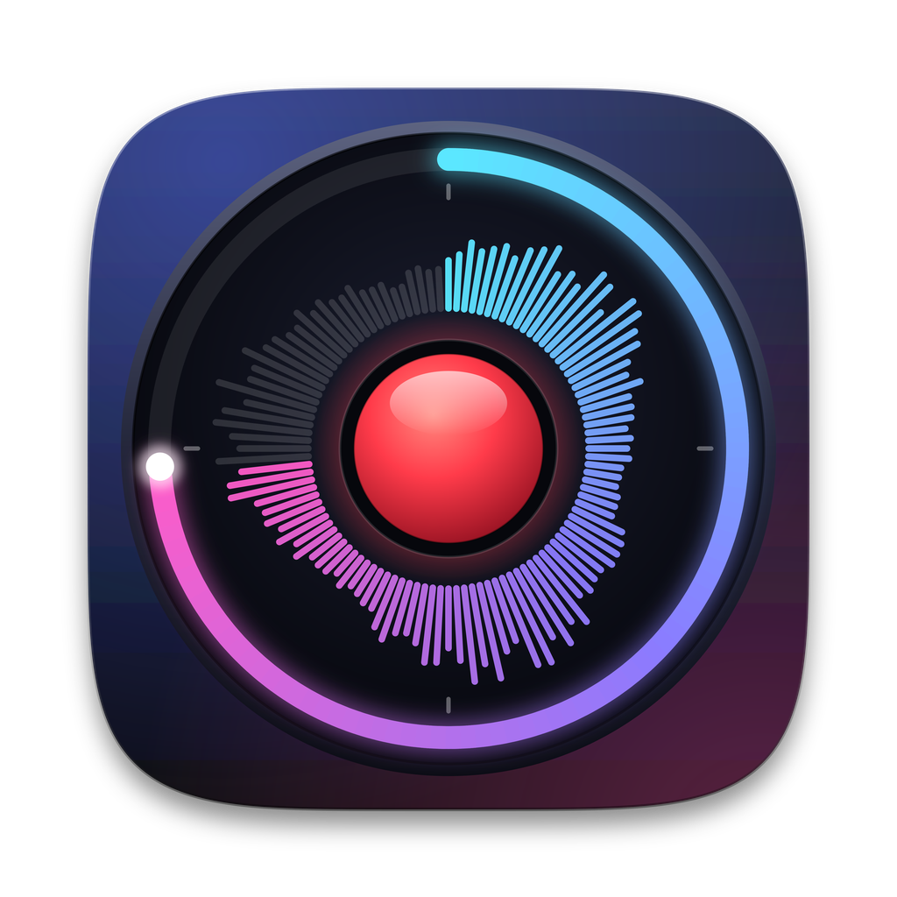
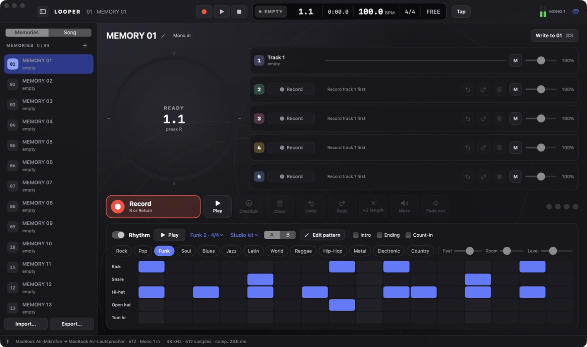
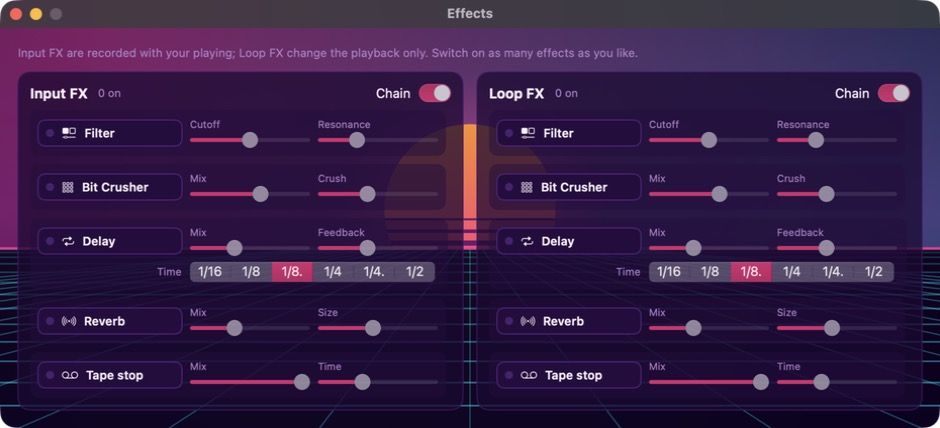

# Looper

**A native macOS phrase looper inspired by the BOSS RC-5 – with five synced tracks, a drummer that sounds like one, effects and song mode.**

Looper turns your Mac and an audio interface into a loop station. Record a phrase, layer overdubs on top, add parts on four more tracks, play along with real recorded drums and chain your loops into a song – all in one window, without a mouse if you like.



*Version 2.0 · macOS 13 Ventura or later · Apple silicon and Intel · SwiftUI + AVAudioEngine, no third-party code*

---

## Contents

- [Features](#features)
- [Getting started](#getting-started)
- [The window](#the-window)
- [Keyboard and MIDI](#keyboard-and-midi)
- [Build it yourself](#build-it-yourself)
- [How it works](#how-it-works)
- [Tips and known limits](#tips-and-known-limits)
- [Version history](#version-history)
- [Credits and license](#credits-and-license)

---

## Features

### Looping
- **RC-5 style recording:** record → overdub → play with one key (R / Return), or use the on-screen buttons. Count-in (1 or 2 bars), auto-record when you start playing, loop quantize to whole bars, a fixed loop length (1–32 bars) that stops recording by itself.
- **Five tracks:** tracks 2–5 record and play in sync with track 1 and can be any number of track-1 loops long (a 2-bar riff over an 8-bar progression). Each track has its own level, mute, undo/redo and clear.
- **Undo history:** up to 5 overdubs can be undone and redone (⌘Z / ⇧⌘Z). Replace mode is undoable too.
- **×2 length** doubles the loop so you can overdub a longer phrase; **Mute** drops the loop while the drums keep going; **Fade out** ends a song smoothly.
- **Live tempo:** change the tempo after recording – the loop follows, with pitch kept (time-stretch) or tape-style varispeed.
- **Reverse, one-shot, fade-in / fade-out, stop at loop end.**

### Rhythm
- **Real drums:** multi-microphone recordings of a real kit (*Big Rusty Drums*, CC0) – up to 7 velocity layers and 4 different takes per drum, mid tom, hi-hat pedal, half-open hat and ride bell.
- **A drummer's feel:** accents on the beat, small timing and dynamic variations per drum, varied fills that land on a crash, damped re-strikes and hi-hat choke, a natural room and gentle bus compression. The **Feel** slider goes from rigid drum machine to loose and human.
- **About 110 patterns** in 15 styles (Rock, Pop, Funk, Soul, Blues, Jazz, Latin, World, Reggae, Hip-Hop, Metal, Electronic, Country, odd meters, metronome), each with an A and B variation, 7 kits, intro and ending.
- **Pattern designer** (*Edit pattern* in the rhythm panel): click steps to make your own grooves (accent / normal / ghost); built-in patterns are copied to your *User* patterns first.
- Without the rhythm, an optional **metronome click** for the count-in, while recording, or always.

### Effects (menu *Effects*)



- **Input FX** (recorded with your playing) and **Loop FX** (playback only), each a full chain: DJ filter, bit crusher, tempo-synced ping-pong delay, reverb and tape stop – switch on any combination. Settings are stored with each memory.

### Memories and songs
- **99 memories** with name, all five tracks, rhythm, tempo, effects and all settings. Rename by double-click.
- **Song mode:** chain memories with repeat counts; the next memory is loaded in the background and starts exactly at the loop end – no gap.
- **Import** any audio file as a loop; **export** a loop as WAV, the whole mix (all tracks + rhythm) as WAV or AAC, or the drum pattern as a MIDI file.

### Audio and MIDI
- Any Core Audio device: input and output device, mono or stereo input (any channel pair), output pair on multichannel interfaces, buffer size, latency compensation.
- **MIDI learn** for 20 actions (record, play/stop, undo, tracks 2–5, ×2, song …) from any pedal, key or knob, plus a fixed remote map.
- **MIDI clock** out (virtual port "Looper") and external clock in (tempo, Start / Stop / Continue).

### Look
- 20 themes, each with its own background artwork and colours – Graphite, Midnight, Synthwave, Aurora, Ember, Ocean, Forest, Daylight, Sunset, Neon City, Terminal, Sakura, Arctic, Vintage Tape, Nebula, Desert Dusk, Arcade, Studio Wood, Candy and Bauhaus (View › Theme, ⌃⌘1…9).

---

## Getting started

1. **Build the apps** (see [Build it yourself](#build-it-yourself)) and open **Looper (arm64).app** on Apple silicon or **Looper (x86_64).app** on an Intel Mac. The apps are ad-hoc signed: the first time, right-click → **Open**.
2. Allow **microphone access** when macOS asks.
3. Open **Settings › Audio** (⌘,) and choose your interface, mono or stereo input, the output pair and the buffer size. Use headphones or monitors – the built-in mic and speakers feed back into the loop.
4. Optional: switch the **Rhythm** on and pick a style, or turn on **Count-in**.
5. Press **R** (or click **Record**) and play. Press **R** again to close the loop – it plays (or goes straight into overdub, depending on *Rec action*).
6. Press **R** to overdub, **Space** to stop and start, **⌘Z** to undo, **2**–**5** to record tracks 2–5.
7. **⌘S** writes everything into the current memory.

---

## The window

| Area | What it does |
|---|---|
| **Toolbar** | Transport (record, play, stop), the display (state, bar.beat, time, tempo – click the BPM to type a tempo), Tap, Rhythm and Count-in switches, loop length, input meter, theme. |
| **Sidebar** | *Memories* (99 slots; double-click to rename, right-click for more) or *Song* (song mode steps). |
| **Ring** | The loop as a circular waveform with the play head, bar ticks and the current bar.beat. |
| **Track lanes** | Track 1 with its overdubs, tracks 2–5 with record / overdub / play buttons, undo, redo, clear, mute and level. |
| **Buttons** | **Record** (only records: start, or close the loop), Play/Stop, Overdub, Clear, Undo, Redo, ×2, Mute, Fade out, beat lights. |
| **Rhythm** | On/off, play, pattern and kit, A/B, **Edit pattern** (the pattern designer), Feel, Room and Level; the style buttons with the Intro / Ending / Count-in options next to them; the step grid. |

Everything fits in one window without scrolling (minimum 1180 × 800). Hide the sidebar (⌃⌘S) or the rhythm panel (⌃⌘R) for more room. The **Effects** window opens from the Effects menu (⌥⌘F), all settings are in **Settings** (⌘,).

---

## Keyboard and MIDI

| Key | Action |
|---|---|
| **R** or **Return** | Record → overdub → play, like the RC-5 pedal (hold 2 s: undo/redo or clear, double-press: stop) |
| **Space** | Play / stop (without a loop: play / stop the rhythm) |
| **Esc** or **S** | Stop |
| **⌘Z / ⇧⌘Z**, **U** | Undo / redo overdubs, U toggles the last one |
| **2 … 5** | Tracks 2–5: record → overdub ↔ play |
| **D** | ×2 loop length |
| **X** | Mute / unmute the loop |
| **F** | Fade out and stop |
| **Delete** or **⌘⌫** | Clear |
| **M** or **⌘R** | Rhythm on / off |
| **B** or **⌘B** | Rhythm variation A / B |
| **T** or **⌘T** | Tap tempo |
| **← / →**, **⌘[ / ⌘]** | Previous / next memory |
| **⌘S** | Write memory |
| **⇧⌘P** | Start / stop the song |
| **⌘I / ⌘E / ⇧⌘E** | Import audio / export loop / export mix or MIDI |
| **⌥⌘F** | Effects window |
| **⌃⌘1 … ⌃⌘9** | Themes |

**MIDI:** Settings › Loop › *MIDI learn* assigns any note, CC or program change to an action. The built-in map also works: CC80 pedal · CC81 stop · CC82 undo · CC83 clear · CC84 rhythm · CC85 variation · CC86 loop level · notes 60–66 · program change 0–98 selects a memory.

---

## Build it yourself

**Requirements:** macOS 13 or later and Xcode 15 or later (or just the Command Line Tools: `xcode-select --install`).

```bash
git clone https://github.com/lydianb79/RC5-Looper.git
cd RC5-Looper
./build_local.sh --open
```

or double-click **`Build Looper.command`** in Finder. The script builds both architectures and puts them in `build/<version>/`:

| App | For |
|---|---|
| `Looper (arm64).app` | Apple silicon Macs (M1 – M4) |
| `Looper (x86_64).app` | Intel Macs (also runs under Rosetta) |

It also writes a zip of each next to the apps. To update, run `git pull` and build again.

Notes:
- `open Package.swift` opens the project in Xcode. For recording, run the app bundle from the script – a bare executable has no microphone usage description, so macOS won't grant it microphone access.
- `release.sh` builds both apps and publishes them as a GitHub release (optional, needs the `gh` CLI). The GitHub workflow in `.github/workflows` can compile-check or build releases in the cloud.
- `python3 Tools/make_icon.py` regenerates the app icon (needs Pillow and `rsvg-convert`); `Tools/drums/build_drums.py` rebuilds the drum samples from the original recordings.

---

## How it works

```
Sources/Looper
├── App/LooperApp.swift            app, windows, menus (Theme submenu in AppKit)
├── Audio/
│   ├── LoopCore.swift             realtime engine: transport state machine, quantize, fades, latency
│   │                              compensation, time-stretch, tracks, FX, song swap, rhythm mixing
│   ├── LayerStack.swift           base + overdub layers of one track: undo history, ×2, merging jobs
│   ├── SubTrack.swift             tracks 2–5, locked to track 1 by cycle and position
│   ├── Effects.swift              effect chains: filter, bit crusher, delay, reverb, tape stop
│   ├── RhythmEngine.swift         step sequencer with groove (accents, timing, dynamics, fills)
│   ├── RhythmLibrary.swift        patterns, kits, user pattern store
│   ├── DrumSamples.swift          sample bank (16-bit, loudness manifest), 64-voice player, synth fallback
│   ├── DrumBus.swift              room reverb (feedback delay network) and bus compressor
│   ├── AudioEngineManager.swift   AVAudioEngine graph: input sink → core → output source
│   └── AudioDevices.swift         Core Audio devices, channels, buffer size
├── Model/                         controller (keys, pedal logic, memories, MIDI, song, export), settings, storage
├── MIDI/                          CoreMIDI in/out, clock, MIDI learn
└── Views/                         main window, track lanes, rhythm panel, effects, song, settings, themes
Resources/                         Info.plist, AppIcon.icns, icon artwork, Drums/ (recordings + manifest)
Tools/                             icon and drum sample generators
build_local.sh, Build Looper.command   local arm64 + x86_64 build
```

- **Realtime safe:** the audio thread never allocates or waits. The UI sends commands through a small queue the audio thread empties with a non-blocking lock; everything else is plain values read once per callback.
- **Layers instead of copies:** every overdub goes into its own layer buffer, so undo and redo just mute or unmute it. Layers that fall out of the history, discarded layers and the ×2 copy are processed a slice per audio callback, so no big copy ever causes a dropout.
- **Tracks in lockstep:** tracks 2–5 never keep their own clock. Their position is derived from track 1 (cycle × length + position), so they stay in sync through tempo changes, restarts, reverse and ×2.
- **Seamless songs:** the next memory is read into spare buffers during the last repeat and swapped in by the audio thread exactly at the loop point.
- **Drums:** each hit picks the recorded layer whose measured loudness matches the velocity, a random take, and is tuned by resampling (Hermite interpolation).

---

## Tips and known limits

- Fine-tune **latency compensation** (Settings › Audio) by ear so overdubs line up with what you heard.
- The buffer size is a device setting and also affects other apps on the same interface.
- Different input and output devices run on separate clocks; if they drift, combine them into an Aggregate Device in Audio MIDI Setup.
- Tracks 2–5 can't record while *Reverse* is on.
- *Keep pitch* stretching is a simple granular method: very large tempo changes can sound a little phasey; *Varispeed* is clean but changes the pitch.
- External MIDI clock follows the tempo and Start / Stop, but isn't locked tick by tick, so very long sessions may drift slightly.
- Memories, songs, user patterns and settings live in `~/Library/Application Support/Looper` and the app's preferences.

---

## Version history

| Version | Changes |
|---|---|
| **2.0** | New studio window that fits on one screen; five synced tracks; undo history (5 steps); ×2, mute and fade out; input and loop effects; song mode; mix and MIDI export; MIDI learn; pattern editor and ~50 new patterns; count-in length and metronome click; much more natural drums (more recordings, groove engine, room); fixed loop length; typed tempo entry; 20 themes; new icon; local build script for both architectures. |
| 1.9 | Stereo input, About window with version, Help menu, count-in and intro also without rhythm. |
| 1.8 | Rhythm intro, ending and fills; external MIDI clock; labelled arm64 / x86_64 builds. |
| 1.7 | Output pair selection for multichannel interfaces. |
| 1.6 | Real recorded drums. |
| 1.0 – 1.5 | First RC-5 style looper with 57 patterns, 99 memories, MIDI control, device and buffer selection, live loop tempo, themes and icon. |

---

## Credits and license

- **Drum recordings:** *Big Rusty Drums* by [Karoryfer Samples](https://karoryfer.com), CC0 – see `Resources/Drums/LICENSE-SAMPLES.md`.
- BOSS and RC-5 are trademarks of Roland Corporation. Looper is an independent project inspired by the RC-5 and is not affiliated with or endorsed by Roland.
